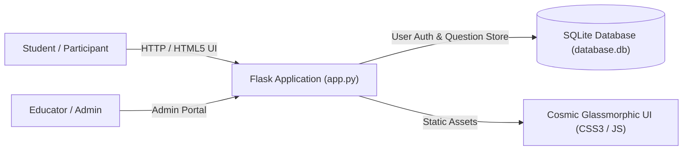

# 🌌 EduGalaxy: Gamified Space-Themed Learning & Quiz Platform

[](https://opensource.org/licenses/MIT)
[](#)
[](#)
[](#)
[](#)

> **EduGalaxy** is an interactive, gamified EdTech platform developed for competitive hackathons. By framing learning modules and assessments as interplanetary cosmic expeditions, EduGalaxy transforms rote study routines into engaging, progress-driven quiz adventures with live leaderboards, badges, and analytics.

---

## 🌟 Core Highlights & Gameplay Mechanics

- 🚀 **Cosmic Knowledge Quests:** Interactive topic-specific quizzes where users conquer space sectors by answering questions correctly.
- 🏆 **Dynamic Live Leaderboard:** Competitive ranking engine tracking player XP, accuracy streaks, and time-to-completion.
- 📊 **Student Performance Analytics:** Visual progress reports breaking down subject strengths, weaknesses, and mastery levels.
- 🛡️ **Instructor & Admin Console:** Secure backend to author new questions, upload quiz decks, and monitor student cohort metrics.
- 📁 **Complete Hackathon Documentation:**
  - 📊 [**Pitch Deck (PPTX)**](./documentation/EduGalaxy_Pitch_Deck.pptx)
  - 📜 [**Project Whitepaper**](./documentation/project_whitepaper.md)
  - 🎯 [**Project Summary**](./documentation/project_summary.md)
  - 🎙️ [**Presentation & Speech Script**](./documentation/presentation_and_speech.md)
  - 🗄️ [**Data Schema Specifications**](./documentation/excel_data_schema.md)

---

## 🏗️ Architecture & Technology Stack



- **Backend:** Python 3, Flask, Jinja2 Templates, Session Authentication.
- **Frontend:** Responsive HTML5, Modern CSS Glassmorphism with cosmic purple/cyan gradients, vanilla JS particle effects.
- **Database:** SQLite with relational tables for Users, Questions, Categories, and Quiz Attempts.
- **Tools:** Automated presentation generator (`make_ppt.py`), PDF data parsing tests (`test_pdf_parsing.py`).

---

## 🚀 Quick Start Guide

### Prerequisites
- [Python 3.10+](https://www.python.org/) installed
- `pip` package manager

### 1. Clone & Set Up Environment

```bash
# Clone the repository
git clone https://github.com/avrojitsaha763-byte/edugalaxy.git
cd edugalaxy

# Create and activate a virtual environment
python -m venv venv
# On Windows:
.\venv\Scripts\activate
# On Linux/macOS:
source venv/bin/activate
```

### 2. Install Dependencies

```bash
pip install -r requirements.txt
```

### 3. Launch the Application

```bash
python app.py
```

The platform will be live at `http://localhost:5000`.

---

## 🗺️ Roadmap & Upgrades

Review the [**TODO.md**](./TODO.md) for our comprehensive phase-by-phase roadmap, including:
- [x] Phase 1: Core gamified quiz engine & user profiles
- [x] Phase 2: Dynamic leaderboard & admin question editor
- [ ] Phase 3: Three.js 3D planetary exploration canvas
- [ ] Phase 4: Text-to-speech AI voiceover narration for accessibility
- [ ] Phase 5: Multiplayer real-time quiz battles using WebSockets

---

## 📂 Repository Structure

```text
├── app.py                      # Core Flask web application & API routing
├── database.db                 # SQLite database storage
├── diagnose.py                 # System health and database verification
├── requirements.txt            # Python dependencies
├── TODO.md                     # Planned feature roadmap
├── templates/                  # Jinja2 HTML views (home, quiz, dashboard, etc.)
├── static/                     # CSS stylesheets, JS animations, and audio/media
└── documentation/              # Complete hackathon pitch deck & whitepaper
```

---

## 📄 License

Distributed under the MIT License. Developed with ❤️ by **[Avrojit Saha](https://github.com/avrojitsaha763-byte)**.
